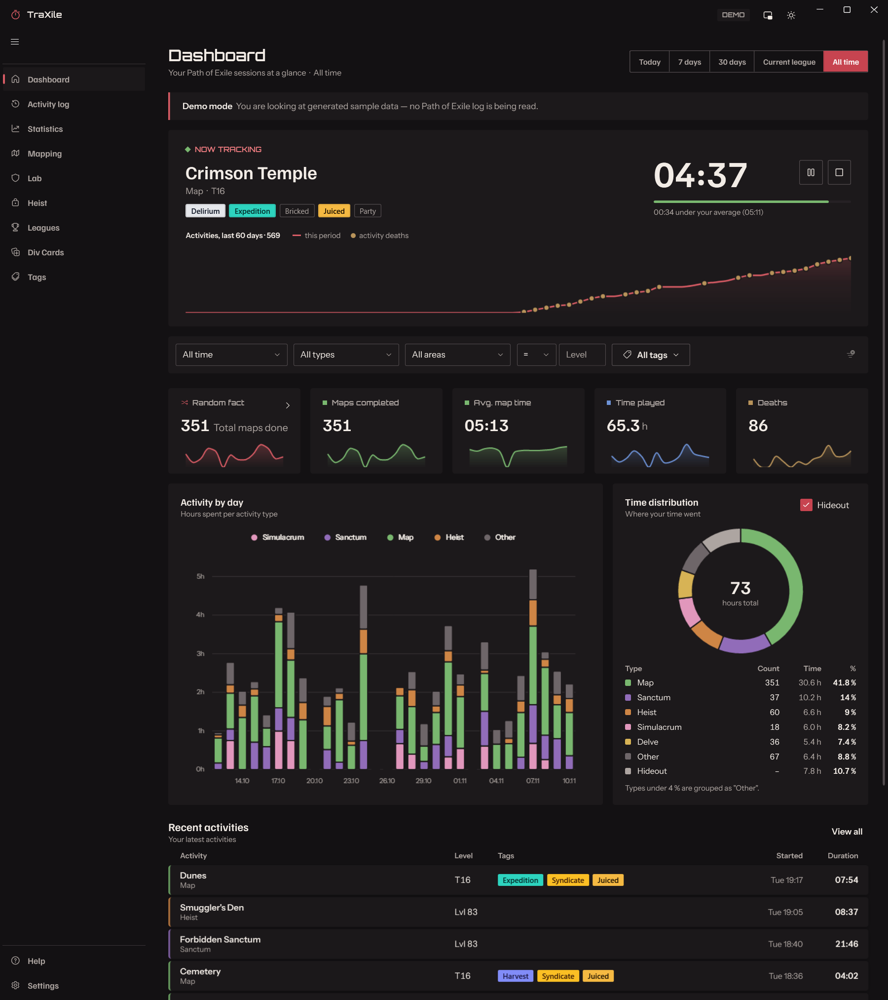
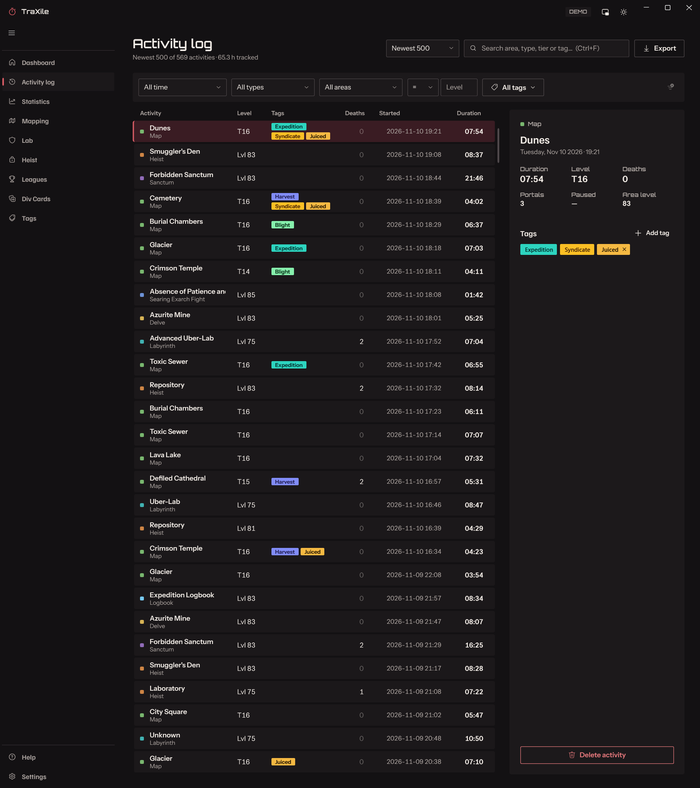
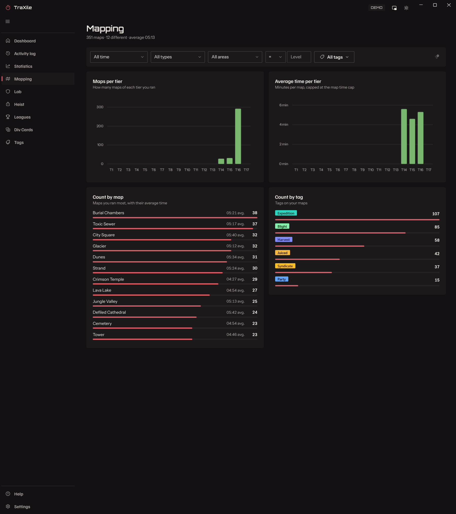
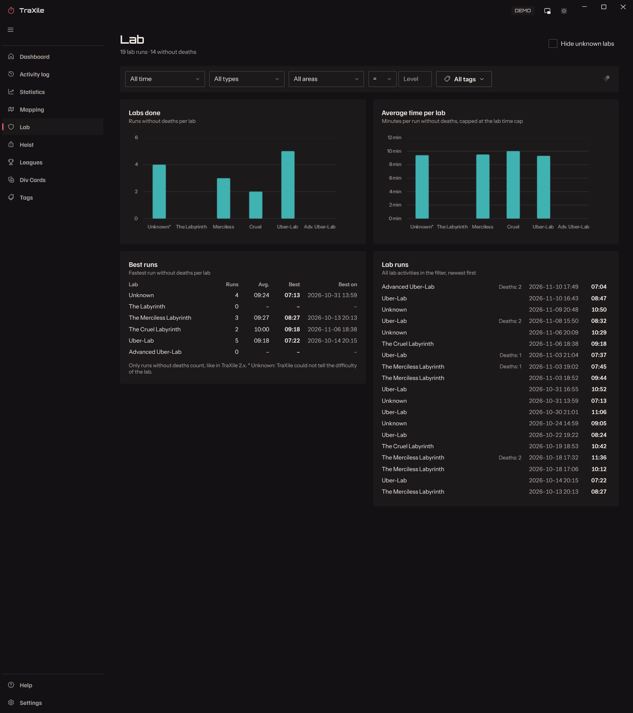
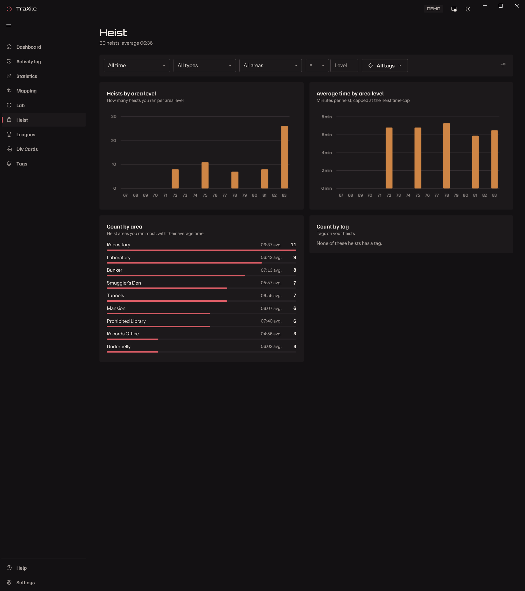
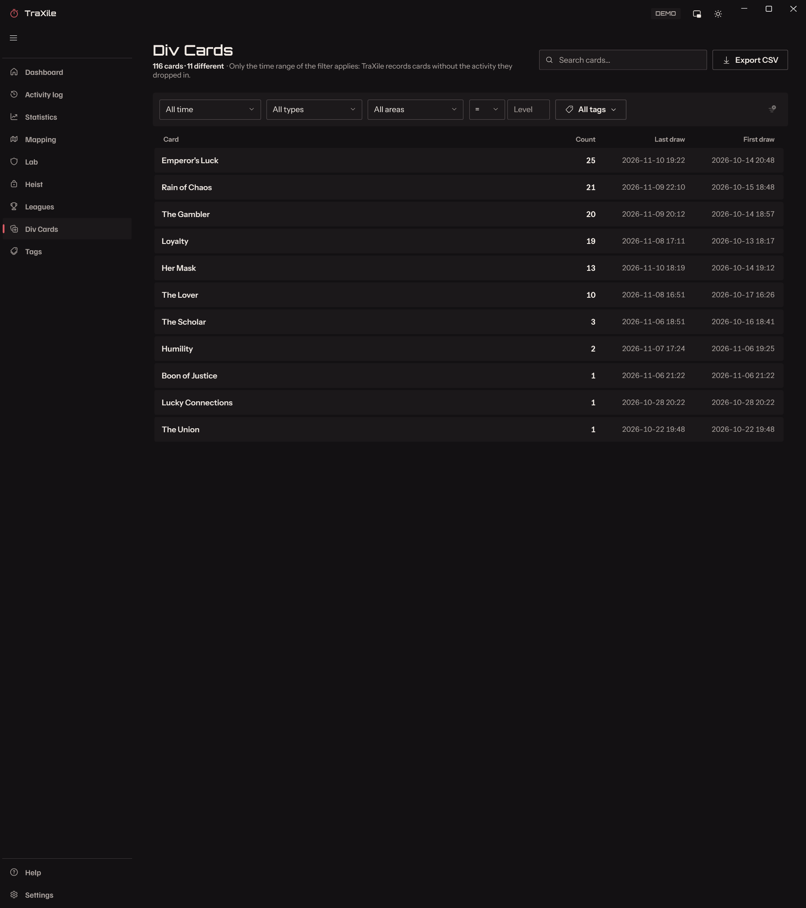
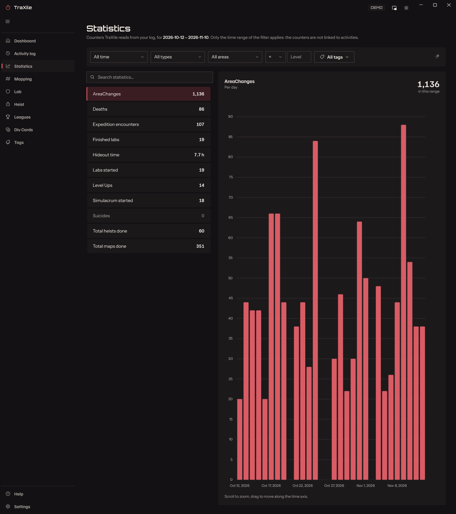
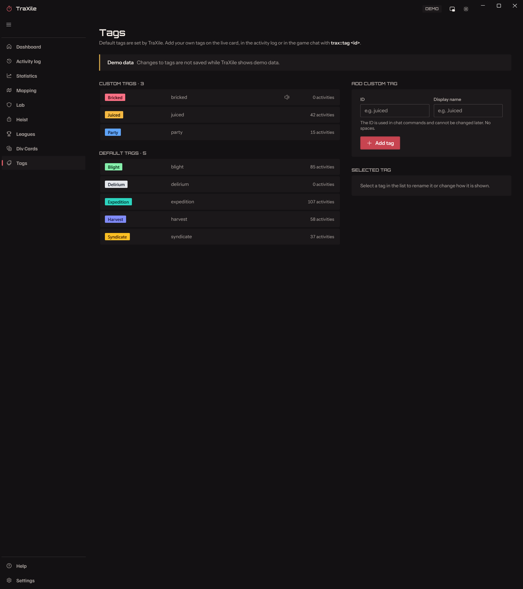
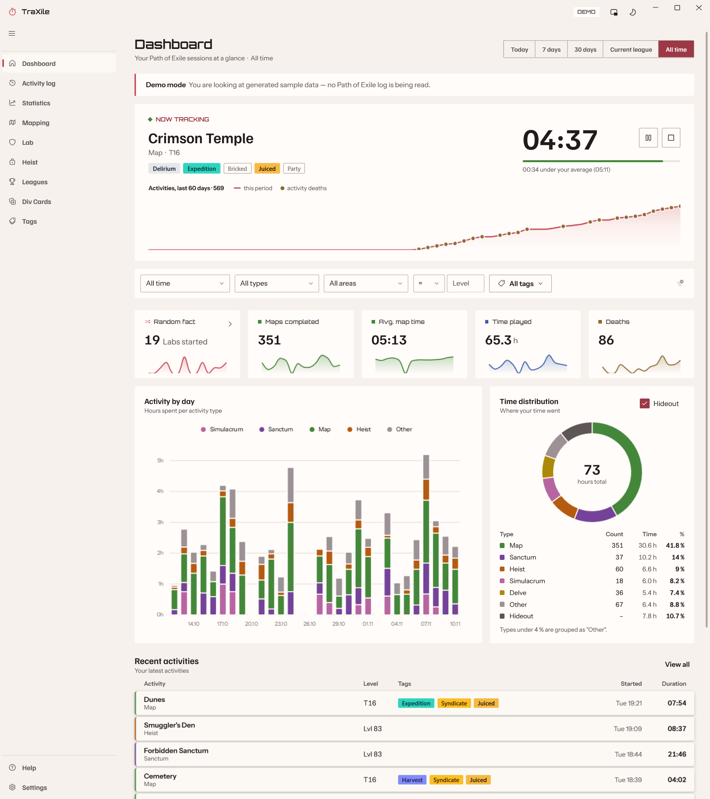

[![Contributors][contributors-shield]][contributors-url]
[![Forks][forks-shield]][forks-url]
[![Stargazers][stars-shield]][stars-url]
[![Issues][issues-shield]][issues-url]
[![MIT License][license-shield]][license-url]


<div align="center">
 
  <p>
    <strong>Track and analyze your Path of Exile activities in real time and historically.</strong>
  </p>
  <p>
    <a href="https://www.youtube.com/watch?v=jZ8eiCNOiM4">▶️ Introduction Video</a> |
    <a href="https://github.com/dermow/TraXile/releases/latest">⬇️ Download Latest Release</a> |
    <a href="https://discord.gg/bc6psDP6U">💬 Discord</a>
  </p>
</div>

<p align="center">
  
</p>


---

## 📑 Table of Contents

- [ℹ️ About](#ℹ%EF%B8%8F-about)
- [✨ Features](#-features)
- [🚀 Getting Started](#-getting-started)
  - [💾 Installation](#-installation)
  - [🛠️ First Steps](#%EF%B8%8F-first-steps)
  - [⬆️ Update](#%EF%B8%8F-update)
- [💬 Chat Commands](#-chat-commands)
- [❓ FAQ](#-faq)
- [📫 Contact & Support](#-contact--support)

---

## ℹ️ About

**TraXile** is a tracking and statistics tool for Path of Exile. It reads your game's client log file and provides real-time and historical statistics about your in-game activities.

TraXile 3.0 comes with a completely new interface: sidebar navigation, animated charts, a global filter on every page and a dark and a light theme.

TraXile is a potential alternative to "Mapwatch," a similar tool that was discontinued. Special thanks to Mapwatch's developer for the inspiration!

---

## ✨ Features

- **Live Tracking ⏱️**  
  The dashboard shows the activity you are in right now: its timer, its tags and how it compares to your average. Pause, resume or finish it with one click, from the overlay or from the game chat. KPIs, time distribution and your recent activities are always one glance away (see the screenshot at the top).

- **Activity Log 📜**  
  Every map, heist, lab, sanctum, boss fight and more, tracked live while TraXile is open and retroactively from your Client.txt. Search by area, type, tier or tag (Ctrl+F), open an activity to see its details and side areas, tag several activities at once, export or delete them.  
  

- **Analytics 📊**  
  Dedicated pages for **Mapping** (maps per tier, average time per tier, most farmed maps), **Lab** (best and average times per difficulty), **Heist** (per area level and area), **Leagues** (your last leagues side by side) and **Div Cards** (every card you picked up, exportable as CSV).  
     
   

- **Statistics 📈**  
  Counters TraXile reads from your log, such as maps done, deaths, labs finished or level ups, each with a zoomable chart over time.  
  

- **Global Filter 🔎**  
  Time range, activity type, area, level and tags: set the filter once and every page follows it.

- **Tags 🏷️**  
  Default tags (Expedition, Blight, Harvest, ...) are set automatically from the game log. Create your own custom tags (e.g. "juiced" or "party"), pick their colors, attach them in the app or with a chat command, and let TraXile play a sound when a tag is set.  
  

- **In-Game Overlays 🖥️**  
  A stopwatch for the current activity and a tag overlay that shows which content you have encountered, while you play.  
   &nbsp; 

- **Dark & Light Theme 🌗**  
  Switch with one click in the title bar.  
  

---

## 🚀 Getting Started

### 💾 Installation

1. **Download** `Setup.msi` from the [releases page](https://github.com/dermow/TraXile/releases/latest).
2. **Run** the installer and follow the on-screen instructions.

TraXile brings everything it needs: there is no .NET runtime or other prerequisite to install. It runs on 64-bit Windows 10 and 11.

**Upgrading from TraXile 2.x?** Just install 3.0. It replaces 2.x and keeps your data (settings, database, tags and overlay positions in `%APPDATA%\TraXile`).

### 🛠️ First Steps

1. **Select your Client.txt log file:**  
   On first launch, TraXile looks for your Path of Exile installations and offers the log files it finds. If yours is not in the list, select it manually.

   **Default locations:**

   | Platform        | Path                                                                 | Example                                                        |
   |-----------------|----------------------------------------------------------------------|----------------------------------------------------------------|
   | Windows (Steam) | `%SteamLibrary%\steamapps\common\Path of Exile\Logs\Client.txt`      | `C:\Steam\steamapps\common\Path of Exile\logs\Client.txt`      |
   | Windows (Standalone) | `%InstallDirectory%\Logs\Client.txt`                            | `C:\Program Files (x86)\Grinding Gear Games\Path of Exile\logs\Client.txt` |
   | Mac (with Crossover) | `/Users/YOUR_USERNAME/Library/Caches/com.GGG.PathOfExile/Logs/Client.txt` | `/Users/mow/Library/Caches/com.GGG.PathOfExile/Logs/Client.txt` |

2. **Import your data:**  
   TraXile imports all historical data from your log file into its internal database. This may take a moment on first use.

### ⬆️ Update

- TraXile checks for new versions at start and then every hour. When an update is available, the update dialog opens at start and a button in the title bar shows the new version. You can also check manually on the Help page.  
  If the automatic update fails, [download the latest release](https://github.com/dermow/TraXile/releases/latest) and install it manually.

---

## 💬 Chat Commands

Type these in any chat channel of Path of Exile (e.g. the local chat) to control TraXile while you play:

| Command | What it does |
|---------|--------------|
| `trax::tag <tag>` | Add a custom tag to the current activity. A tag that does not exist yet is created. |
| `trax::untag <tag>` | Remove a custom tag from the current activity. |
| `trax::pause` | Pause the tracking of the current activity. |
| `trax::resume` | Resume paused tracking. |
| `trax::finish` | Finish the current activity now. |

---

## ❓ FAQ

### TraXile isn't tracking any activities, even with the correct Client.txt path
Make sure your local area chat is enabled; TraXile depends on these log lines.

### Why can't I filter data by character name?
Unfortunately, the Client.txt log file does not include the character name.

### Do I need TraXile running while playing to track activities?
No. TraXile reads all data in your Client.txt file, so past activities are tracked even if TraXile wasn't running.

### Why does Windows warn me during installation?
As an independent developer, I do not use a Code Signing certificate, which causes Windows to show a warning.

### Does the app send data to the Internet?  
Only to check for new versions and download some metadata (e.g., league dates).

### Why isn't this a web-based application?
Continuous log file reading is much easier with a desktop app.

### Can I install TraXile on Mac?
TraXile is designed for Windows, but you can use Crossover to install it on Mac.  
[Unifer1's Reddit Guide](https://www.reddit.com/user/Unifer1/) (written for TraXile 2.x):

```
- Install Crossover
- "Install a new bottle" → "Install an unlisted application"
- Create a Windows 10 64-bit bottle named TraXile
- Select and install the `Setup.msi`
- On first run, select your Client.txt log file
- Should work automatically after setup
```

### Can I install TraXile on Linux?
TraXile is not natively supported on Linux, but it can run using Wine. These steps were written for TraXile 2.x:

- Install the required dependencies:
  
  `sudo pacman -S wine mono lib32-gnutls`
  
  `cert-sync /etc/ssl/certs/ca-certificates.crt`

- Run `TraXile.exe` or the MSI installer using Wine: `wine TraXile.exe`

- On first launch, TraXile prompts for your `Client.txt` log file location. Wine uses its own file browser, which cannot see hidden directories such as `.steam`.

  To work around this, create a symlink in your home directory:
  
  `ln -s .steam steam`

  This allows the Wine file browser to navigate into your Steam game folders.

  Once these steps are complete, TraXile should function normally on Linux. Keep in mind that system integration features (like auto-updates) may be limited compared to native Windows.

---

## 📫 Contact & Support

- **Discord:** [join the server](https://discord.gg/bc6psDP6U) for questions, ideas and feedback
- **GitHub:** [report an issue](https://github.com/dermow/TraXile/issues) or browse [my other projects](https://github.com/dermow/)
- **Reddit:** [u/graring](https://reddit.com/user/graring)
- **Patreon:** [support the development](https://www.patreon.com/c/dermow)

Something does not work? Open the **Help** page in TraXile and create a support bundle: it contains everything needed to reproduce the problem. Attach it to your issue.

---

<!-- MARKDOWN LINKS & IMAGES -->
[contributors-shield]: https://img.shields.io/github/contributors/dermow/TraXIle.svg?style=for-the-badge
[contributors-url]: https://github.com/dermow/TraXile/graphs/contributors
[forks-shield]: https://img.shields.io/github/forks/dermow/TraXile.svg?style=for-the-badge
[forks-url]: https://github.com/dermow/TraXile/network/members
[stars-shield]: https://img.shields.io/github/stars/dermow/TraXile.svg?style=for-the-badge
[stars-url]: https://github.com/dermow/TraXile/stargazers
[issues-shield]: https://img.shields.io/github/issues/dermow/TraXile.svg?style=for-the-badge
[issues-url]: https://github.com/dermow/TraXile/issues
[license-shield]: https://img.shields.io/github/license/dermow/TraXile.svg?style=for-the-badge
[license-url]: https://github.com/dermow/TraXile/blob/master/LICENSE.txt
